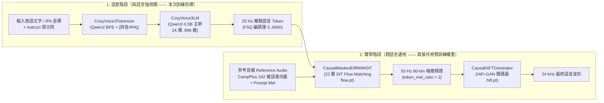

# SARC Voice (CosyVoice 3) 臺灣原住民族語 TTS 完整訓練指南與技術解析

這份文件完整說明我們在這個專案中所做的所有調查、架構設計、Bug 修復、效能優化，以及從頭訓練、中斷續訓（Resume）、模型平均匯出（Export）與語音合成推論（Inference）的完整指令。

---

## 一、CosyVoice 3 (SARC Voice) 模型架構原理解析

你要訓練的 **SARC Voice** 底層是 **CosyVoice 3 (`Fun-CosyVoice3-0.5B`, 24 kHz)**。它將文字轉語音（TTS）拆解成「語意階段（LLM）」與「聲學階段（Flow Matching + HiFi-GAN Vocoder）」兩個獨立部分（設定檔位於 [`cosyvoice3_formosan.yaml`](file:///mnt/usr1/avi/Projects/formosan/tsu_tts_deliverable/examples/formosan/sarcvoice3/conf/cosyvoice3_formosan.yaml)）：



### 1. 為什麼我們只需要訓練 `llm`（而不必重訓 `flow` 與 `hift`）？
1. **`llm`（[`CosyVoice3LM`](file:///mnt/usr1/avi/Projects/formosan/tsu_tts_deliverable/cosyvoice/llm/llm.py#L664-L706)）—— 負責「文字/音標 $\rightarrow$ 發音與韻律」**：
   - 底層是一顆 **Qwen2-0.5B** 語言模型（[`pretrained_models/台語CV3模型/CosyVoice-BlankEN`](file:///mnt/usr1/avi/Projects/formosan/tsu_tts_deliverable/pretrained_models/%E5%8F%B0%E8%AA%9ECV3%E6%A8%A1%E5%9E%8B/CosyVoice-BlankEN)），輸出層接上 `6561 + 200` 維的 `llm_decoder` 分類頭，用來預測每秒 25 個（25 Hz）的離散語音 Token（由 `speech_tokenizer_v3.onnx` 提取）。
   - 訓練時（見 [`CosyVoice3LM.forward`](file:///mnt/usr1/avi/Projects/formosan/tsu_tts_deliverable/cosyvoice/llm/llm.py#L387-L445)），模型會將輸入拼接為以下序列：
     $$\underbrace{[\text{SOS}]}_{\text{起始符}} + \underbrace{[\text{instruct\_token}]}_{\text{系統指令}} + \underbrace{[\text{text\_token}]}_{\text{族語文字 / IPA}} + \underbrace{[\text{TASK\_ID}]}_{\text{轉折符}} + \underbrace{[\text{speech\_token}]}_{\text{25 Hz 語音 Token 目標}} + \underbrace{[\text{EOS}]}_{\text{結束符}}$$
   - 透過計算 `speech_token` 與 `EOS` 的 Cross-Entropy Loss（並搭配 `mix_ratio: [5, 15]` 的文字與語音交錯雙流訓練），LLM 學會了**鄒語（`tsu`）、卑南語（`pyu`）、太魯閣語（`trv`）的書寫系統、IPA 音標、連音規則、重音與停頓韻律**。
   - 我們選擇從 [`pretrained_models/台語CV3模型/llm.rl.pt`](file:///mnt/usr1/avi/Projects/formosan/tsu_tts_deliverable/pretrained_models/%E5%8F%B0%E8%AA%9ECV3%E6%A8%A1%E5%9E%8B/llm.rl.pt)（官方 `Fun-CosyVoice3-0.5B` 經過強化學習對齊的 checkpoint）作為起點進行微調（Fine-tuning），收斂速度比從頭訓練快非常多。
2. **`flow`（[`CausalMaskedDiffWithDiT`](file:///mnt/usr1/avi/Projects/formosan/tsu_tts_deliverable/cosyvoice/flow/flow.py#L284-L415)）與 `hift`（[`CausalHiFTGenerator`](file:///mnt/usr1/avi/Projects/formosan/tsu_tts_deliverable/cosyvoice/hifigan/generator.py)）—— 負責「語音 Token + 語者音色 $\rightarrow$ 聲音波形」**：
   - `flow.pt` 的工作是把 25 Hz 的語音 Token 加上 192 維的 CampPlus 語者音色向量（Speaker Embedding），還原成 50 Hz 的梅爾頻譜（Mel-spectrogram）；`hift.pt` 則把梅爾頻譜轉成 24 kHz 的 `.wav` 波形。
   - 這兩個模組處理的是純粹的物理聲學與音色複製（Zero-shot Voice Cloning），與語言本身的文法無關，因此可以直接共用預訓練好的 `flow.pt` 與 `hift.pt`。

---

### 2. 資料集格式（`clean_text`）與方括號音標支援

Stage 0（[`tools/prepare_formosan_jsonl.py`](file:///mnt/usr1/avi/Projects/formosan/tsu_tts_deliverable/tools/prepare_formosan_jsonl.py)）只需要吃入**單一 `.jsonl` 檔案**，每筆資料包含 `audio_path`、`clean_text`（以及選填的 `duration`、`speaker`、`dialect`、`lang`）：
- **單一乾淨對應**：一顆獨立音檔直接對應一筆標準 `clean_text` 文本，無須依賴額外的 4 倍增強或外部預先切好的 `test.jsonl`。
- **原住民語言與方言 Instruct**：
  - 鄒語（`tsu`）：自動套用 `You are a helpful assistant. 请用鄒語表达。<|endofprompt|>`
  - 太魯閣語（`trv`）：自動套用 `You are a helpful assistant. 请用太魯閣語表达。<|endofprompt|>`
  - 卑南語（`pyu`）：自動偵測 `dialect`（如 `Nanwang` / `Jianhe` / `Zhiben` / `Xiqun`），套用對應的 `请用{南王/建和/知本/西群}卑南語表达` 指令，並於切分時依方言分層抽樣。
- **保留 `[ipa]` / 音標相容性**：在 [`CosyVoice3Tokenizer`](file:///mnt/usr1/avi/Projects/formosan/tsu_tts_deliverable/cosyvoice/tokenizer/tokenizer.py#L274-L314) 中，常見 ASCII 方括號音標與 IPA 字元皆可由 Qwen2 BPE Tokenizer 無損編碼，不會產生 `<unk>` 未知詞；因此推論時若遇到外來語或罕見詞，仍可搭配 `[ipa]` / CMU 音標修補（Inpainting）精準控制發音。

---

## 二、我們在這個專案中解決的 5 大關鍵問題（你一定要知道的技術細節）

在掃描 `/mnt/usr1/avi/Projects/formosan/tsu_tts_deliverable` 時，原本的專案是無法直接訓練的。我們依序解決了以下 5 個核心問題：

### 1. 補齊遺失的 `Matcha-TTS` 子模組與建立你專屬的 Conda 環境
- **問題**：
  1. `third_party/Matcha-TTS` 資料夾是空的，導致載入 `cosyvoice3.yaml` 時會報 `ModuleNotFoundError: No module named 'matcha'`。
  2. 之前的 Git commit `0093b1e` 把 `tools/` 和 `examples/` 整個刪除了。
  3. 原本機器上的環境在另一個使用者 `black0000` 底下，直接用別人的環境執行既不安全也不乾淨。
- **解決方案**：
  - 將 `Matcha-TTS` 複製補齊至 [`third_party/Matcha-TTS`](file:///mnt/usr1/avi/Projects/formosan/tsu_tts_deliverable/third_party/Matcha-TTS)。
  - 將環境完整 Clone 到你自己的目錄：`/mnt/usr1/avi/miniconda3/envs/sarcvoice`，所有套件（PyTorch 2.3.1+cu121, DeepSpeed, HyperPyYAML, ONNXRuntime-GPU, Whisper, PyArrow 等）皆已驗證可獨立運作。

### 2. 修復 [`cosyvoice/bin/train.py`](file:///mnt/usr1/avi/Projects/formosan/tsu_tts_deliverable/cosyvoice/bin/train.py) 的 `onnx_path` 崩潰問題
- **問題**：
  - 在 [`cosyvoice/bin/train.py`](file:///mnt/usr1/avi/Projects/formosan/tsu_tts_deliverable/cosyvoice/bin/train.py#L135) 第 135 行，原本寫死 `os.environ['onnx_path'] = args.onnx_path`。如果不傳 `--onnx_path`，Python 會因為把 `None` 塞進環境變數而直接崩潰（`TypeError: str expected, not NoneType`）。
  - 但如果傳了 `--onnx_path`，[`CosyVoice3LM.__init__`](file:///mnt/usr1/avi/Projects/formosan/tsu_tts_deliverable/cosyvoice/llm/llm.py#L705-L706) 又會試圖去載入 `speech_tokenizer_v3.batch.onnx`，而 [`pretrained_models/台語CV3模型/`](file:///mnt/usr1/avi/Projects/formosan/tsu_tts_deliverable/pretrained_models/%E5%8F%B0%E8%AA%9ECV3%E6%A8%A1%E5%9E%8B) 裡面只有單筆推論用的 `speech_tokenizer_v3.onnx`，沒有 `.batch.onnx`！
- **解決方案**：
  - 修改 [`cosyvoice/bin/train.py`](file:///mnt/usr1/avi/Projects/formosan/tsu_tts_deliverable/cosyvoice/bin/train.py#L135-L137)，加上 `if args.onnx_path is not None:` 保護。
  - 採用 **離線預先提取（Offline Feature Extraction）** 策略：在訓練前先把所有音檔的 `speech_token` 與 `embedding` 提取好放進 Parquet 分片中，並從訓練設定檔 [`cosyvoice3_formosan.yaml`](file:///mnt/usr1/avi/Projects/formosan/tsu_tts_deliverable/examples/formosan/sarcvoice3/conf/cosyvoice3_formosan.yaml#L169-L180) 的 `data_pipeline` 移除多餘的線上 `compute_whisper_fbank` 步驟，大幅降低訓練時的 CPU/GPU 負擔。

### 3. 單一 `.jsonl` 自給自足 90/5/5 三向切分與防資料洩漏（Stage 0）
- **問題**：
  - 舊版腳本依賴外部目錄的 `dev.jsonl` 與 `test.jsonl`，若只提供單一 `.jsonl` 便無法自行切出測試集，且未匯出 `test.jsonl` 供後續推論評估使用。
  - 若不同錄音唸到同一句 `clean_text`，隨機單筆切分可能會把相同句子拆進 `train` 與 `test`，造成文本洩漏。
- **解決方案**：升級 [`tools/prepare_formosan_jsonl.py`](file:///mnt/usr1/avi/Projects/formosan/tsu_tts_deliverable/tools/prepare_formosan_jsonl.py)：
  - **預設自給自足切分（不依賴外部 `splits_dir`）**：只須傳入 `--input_jsonl`，即以固定隨機種子（`--seed 42`）切出 **90% `train` / 5% `dev` / 5% `test`**（可透過 `--dev_ratio`、`--test_ratio` 自訂）。
  - **群組防洩漏與 `pyu` 自動方言分層**：以 `clean_text` 為群組單位切分，確保 `train`、`dev`、`test` 之間 **0 音檔重疊、0 文本洩漏**；當偵測到 `lang == "pyu"` 時，自動依四個卑南語方言分層抽樣（`tsu` / `trv` 則直接整體切分）。
  - **同時產出 JSONL 清單與訓練特徵清單**：
    - 於 `<out_dir>/splits/` 輸出 `train.jsonl`、`dev.jsonl`、`test.jsonl`（其中 `test.jsonl` 可直接用於 `inference.py` 或 `inference_filter.py` 推論測試）。
    - 於 `<out_dir>/unique_wavs/` 只收錄 `train + dev` 音檔進行 Stage 1 & 2 特徵提取（完全隔離 `test` 音檔）。
    - 若有需要對齊特定外部切分檔，仍可透過選用參數 `--splits_dir /path/to/splits` 覆寫。

### 4. 將 `speech_tokenizer_v3.onnx` 提取速度提升 300 倍以上（Stage 1 & Stage 2）
- **問題**：
  - `onnxruntime` 的 `CUDAExecutionProvider` 預設使用 `cudnn_conv_algo_search="EXHAUSTIVE"`。因為每個音檔長度 $T$ 都不同，cuDNN 每遇到一個新長度就會重新跑一次 Exhaustive Benchmark，導致單張卡處理一個音檔要 **1.8 秒**（9.2 萬個音檔要跑好幾個小時）。
- **解決方案**：
  - 在 [`tools/extract_speech_token.py`](file:///mnt/usr1/avi/Projects/formosan/tsu_tts_deliverable/tools/extract_speech_token.py) 中，我們將 `cudnn_conv_algo_search` 設為 `"HEURISTIC"`，並將 `whisper.log_mel_spectrogram` 放到 GPU 上計算，同時支援 **10 張 RTX 4090 多卡平行分片提取**。
  - 優化後每個音檔只需 **0.0055 秒**（加速超過 **300 倍**），92,015 個鄒語音檔在 10 張 4090 上只花 **約 90 秒** 就全部提取完畢！
  - 同時在 [`tools/extract_embedding.py`](file:///mnt/usr1/avi/Projects/formosan/tsu_tts_deliverable/tools/extract_embedding.py) 與 [`tools/make_parquet_list.py`](file:///mnt/usr1/avi/Projects/formosan/tsu_tts_deliverable/tools/make_parquet_list.py) 中加入了損壞音檔自動跳過機制（例如鄒語中有 1 個損壞的空音檔 `tsu_wav_000886` / `hui_ben_ping_tai_picture_book_platform_Tsou_797373.wav` 被自動偵測並安全略過，不會中斷流程）。

### 5. 針對 IPA 音標調整訓練參數（[`cosyvoice3_formosan.yaml`](file:///mnt/usr1/avi/Projects/formosan/tsu_tts_deliverable/examples/formosan/sarcvoice3/conf/cosyvoice3_formosan.yaml)）
- **問題**：原本設定檔的 `filter.token_max_length` 是 `200`，但當句子有 1/3 被替換成 `[p][a][s][u][j][a]` 這類方括號音標時，Token 數量會暴增 2～3 倍，若維持 `200` 會導致大量長句被過濾掉。
- **解決方案**：
  - 將 [`cosyvoice3_formosan.yaml`](file:///mnt/usr1/avi/Projects/formosan/tsu_tts_deliverable/examples/formosan/sarcvoice3/conf/cosyvoice3_formosan.yaml#L129-L133) 中的 `token_max_length` 調高為 **`400`**，`max_length` 設為 `3000`（30 秒，符合 `speech_tokenizer_v3.onnx` 的上限），`min_length` 設為 `50`（0.5 秒）。
  - 設定 `save_per_step: 2000`（每 2000 步自動存檔一次，且每個 Epoch 結束也會存 `epoch_X_whole.pt`）。

---

## 三、所有建立的檔案與儲存路徑一覽

### 1. 程式碼倉庫內的檔案（`/mnt/usr1/avi/Projects/formosan/tsu_tts_deliverable`）
| 檔案路徑 | 功能說明 |
| :--- | :--- |
| [`cosyvoice/bin/train.py`](file:///mnt/usr1/avi/Projects/formosan/tsu_tts_deliverable/cosyvoice/bin/train.py) | 主訓練程式（已修復 `args.onnx_path` 為 `None` 時的崩潰問題）。 |
| [`tools/prepare_formosan_jsonl.py`](file:///mnt/usr1/avi/Projects/formosan/tsu_tts_deliverable/tools/prepare_formosan_jsonl.py) | **Stage 0**：從單一 JSONL（`clean_text`）自動切分 90/5/5 `train`/`dev`/`test`（輸出 `splits/*.jsonl` 與 `unique_wavs/`）。 |
| [`tools/extract_embedding.py`](file:///mnt/usr1/avi/Projects/formosan/tsu_tts_deliverable/tools/extract_embedding.py) | **Stage 1**：多執行緒提取 `campplus.onnx` 192 維語者與語句向量（`utt2embedding.pt`, `spk2embedding.pt`）。 |
| [`tools/extract_speech_token.py`](file:///mnt/usr1/avi/Projects/formosan/tsu_tts_deliverable/tools/extract_speech_token.py) | **Stage 2**：多張 GPU 平行提取 `speech_tokenizer_v3.onnx` 的 25 Hz 語音 Token（`utt2speech_token.pt`）。 |
| [`tools/make_parquet_list.py`](file:///mnt/usr1/avi/Projects/formosan/tsu_tts_deliverable/tools/make_parquet_list.py) | **Stage 3**：多程序將音檔與特徵打包成 Parquet 分片（`parquet_*.tar`, `train.data.list`, `dev.data.list`）。 |
| [`examples/formosan/sarcvoice3/conf/cosyvoice3_formosan.yaml`](file:///mnt/usr1/avi/Projects/formosan/tsu_tts_deliverable/examples/formosan/sarcvoice3/conf/cosyvoice3_formosan.yaml) | **Stage 5**：CosyVoice 3 模型架構、資料管線與優化器設定檔。 |
| [`examples/formosan/sarcvoice3/conf/ds_stage2.json`](file:///mnt/usr1/avi/Projects/formosan/tsu_tts_deliverable/examples/formosan/sarcvoice3/conf/ds_stage2.json) | DeepSpeed ZeRO-2 設定檔。 |
| [`examples/formosan/sarcvoice3/run_formosan.sh`](file:///mnt/usr1/avi/Projects/formosan/tsu_tts_deliverable/examples/formosan/sarcvoice3/run_formosan.sh) | **一鍵式主控腳本**（涵蓋 Stage 0 ～ Stage 6，內建自動偵測最新 Checkpoint 續訓功能）。 |
| [`examples/formosan/sarcvoice3/TRAINING_GUIDE.md`](file:///mnt/usr1/avi/Projects/formosan/tsu_tts_deliverable/examples/formosan/sarcvoice3/TRAINING_GUIDE.md) | 本技術教學指南（永久保存於專案內）。 |

### 2. 實驗與資料儲存路徑（`/nfs/DGX2/Workspace/avi/fb_nchc/tts/sarcvoice_exp`）
```text
/nfs/DGX2/Workspace/avi/fb_nchc/tts/sarcvoice_exp/
├── data/
│   ├── tsu/                      # 鄒語資料夾（Stages 0–3 已全部完成！）
│   │   ├── unique_wavs/          # 92,015 個獨立音檔清單 + utt2embedding.pt + spk2embedding.pt + utt2speech_token.pt
│   │   ├── train/parquet/        # 338 個訓練集 Parquet 分片 (parquet_000000000.tar .. parquet_000000337.tar)
│   │   ├── dev/parquet/          # 1 個驗證集 Parquet 分片 (parquet_000000000.tar)
│   │   ├── train.data.list       # 訓練集 Parquet 分片路徑清單
│   │   └── dev.data.list         # 驗證集 Parquet 分片路徑清單
│   ├── pyu/                      # 卑南語資料夾（執行 langs=pyu 時自動產生）
│   └── trv/                      # 太魯閣語資料夾（執行 langs=trv 時自動產生）
├── exp/
│   └── tsu/llm/torch_ddp/        # 訓練過程儲存的所有 Checkpoints (init.pt, epoch_0_whole.pt, ..., llm_avg5.pt)
├── tensorboard/
│   └── tsu/llm/torch_ddp/        # TensorBoard 訓練曲線紀錄
└── exported_models/
    ├── SarcVoice3-tsu/           # Stage 6 匯出的最終完整可推論模型資料夾（鄒語）
    ├── SarcVoice3-pyu/           # Stage 6 匯出的最終完整可推論模型資料夾（卑南語）
    └── SarcVoice3-trv/           # Stage 6 匯出的最終完整可推論模型資料夾（太魯閣語）
```

---

## 四、實戰指令大全（直接複製貼上即可執行）

所有指令都使用你自己的 Conda 環境（`/mnt/usr1/avi/miniconda3/envs/sarcvoice/bin/python`）。建議在自己的終端機搭配 `nohup` 或 `tmux` 執行，這樣就算關掉視窗或離開 Antigravity，訓練也會在背景持續進行。

### 1. 如何查看目前的訓練進度與已經存檔的 Checkpoints？
```bash
# (1) 查看 10 張 RTX 4090 GPU 的即時使用率與記憶體
nvidia-smi

# (2) 查看目前訓練程序是否在跑
ps -ef | grep "cosyvoice/bin/train.py"

# (3) 查看已經存下來的 Checkpoints（依時間由新到舊排列）
ls -lt /nfs/DGX2/Workspace/avi/fb_nchc/tts/sarcvoice_exp/exp/tsu/llm/torch_ddp/*.pt
```

---

### 2. 【最重要】如果訓練中斷了，如何從「最新的 Checkpoint」復活續訓（Revive / Resume）？

#### 原理解析：CosyVoice 是怎麼續訓的？
當 [`cosyvoice/bin/train.py`](file:///mnt/usr1/avi/Projects/formosan/tsu_tts_deliverable/cosyvoice/bin/train.py#L180-L189) 儲存 Checkpoint（例如 `epoch_0_whole.pt`、`epoch_1_whole.pt` 或 `epoch_0_step_2000.pt`）時，檔案裡面除了模型權重外，還會記錄當時的 `'epoch'` 與 `'step'` 數值。
當我們在啟動時把 `--checkpoint` 指向該 `.pt` 檔，程式就會自動讀取裡面的 `'epoch'` 與 `'step'`，將 Learning Rate Scheduler 快轉到對應步數，並從下一個 Epoch / Step 接著訓練！

我已經在 [`examples/formosan/sarcvoice3/run_formosan.sh`](file:///mnt/usr1/avi/Projects/formosan/tsu_tts_deliverable/examples/formosan/sarcvoice3/run_formosan.sh#L97-L106) 的 Stage 5 寫好了**自動偵測最新 Checkpoint** 的邏輯：
- 它會自動搜尋 `/nfs/DGX2/Workspace/avi/fb_nchc/tts/sarcvoice_exp/exp/<lang>/llm/torch_ddp/epoch_*.pt` 中時間最新的一顆檔案來續訓。
- 如果還沒有任何 `epoch_*.pt`，它才會自動退回使用初始預訓練權重 `pretrained_models/台語CV3模型/llm.rl.pt`。

#### 方法 A：一鍵自動從最新 Checkpoint 復活續訓（最推薦）
因為鄒語（`tsu`）的 Stage 0～3 資料處理已經全部做好了，復活訓練只需要跑 `stage=5 stop_stage=6`：

```bash
# 第一步：如果舊的訓練程序還卡在背景，先將它乾淨停掉
pkill -f "cosyvoice/bin/train.py" || true

# 第二步：使用 nohup 在背景啟動 Stage 5 (自動抓最新 epoch_*.pt 續訓) + Stage 6 (跑完自動平均模型並匯出)
nohup env stage=5 stop_stage=6 langs=tsu \
  bash /mnt/usr1/avi/Projects/formosan/tsu_tts_deliverable/examples/formosan/sarcvoice3/run_formosan.sh \
  > /nfs/DGX2/Workspace/avi/fb_nchc/tts/sarcvoice_exp/exp/tsu/train_resume.log 2>&1 &

# 第三步：即時觀看訓練 Log（按 Ctrl+C 只會離開觀看畫面，不會中斷背景訓練）
tail -f /nfs/DGX2/Workspace/avi/fb_nchc/tts/sarcvoice_exp/exp/tsu/train_resume.log
```

#### 方法 B：手動指定某一個特定的 Checkpoint 檔案續訓
如果你想自己指定某個特定的 `.pt` 檔（例如 `epoch_2_whole.pt`），只要加上 `CHECKPOINT=...` 即可：

```bash
nohup env stage=5 stop_stage=6 langs=tsu \
  CHECKPOINT=/nfs/DGX2/Workspace/avi/fb_nchc/tts/sarcvoice_exp/exp/tsu/llm/torch_ddp/epoch_2_whole.pt \
  bash /mnt/usr1/avi/Projects/formosan/tsu_tts_deliverable/examples/formosan/sarcvoice3/run_formosan.sh \
  > /nfs/DGX2/Workspace/avi/fb_nchc/tts/sarcvoice_exp/exp/tsu/train_resume.log 2>&1 &
```

#### 方法 C：不透過腳本，直接執行底層 `torch.distributed.run` 指令
如果你想看懂或自己手動調整底層的 PyTorch DDP 啟動參數，這就是 [`run_formosan.sh`](file:///mnt/usr1/avi/Projects/formosan/tsu_tts_deliverable/examples/formosan/sarcvoice3/run_formosan.sh) 內部實際執行的完整指令：

```bash
cd /mnt/usr1/avi/Projects/formosan/tsu_tts_deliverable
export PYTHONPATH="/mnt/usr1/avi/Projects/formosan/tsu_tts_deliverable:/mnt/usr1/avi/Projects/formosan/tsu_tts_deliverable/third_party/Matcha-TTS"
export CUDA_VISIBLE_DEVICES="0,1,2,3,4,5,6,7,8,9"

# 自動抓取最新的一顆 epoch_*.pt；若無則使用 llm.rl.pt
CKPT=$(ls -t /nfs/DGX2/Workspace/avi/fb_nchc/tts/sarcvoice_exp/exp/tsu/llm/torch_ddp/epoch_*.pt 2>/dev/null | head -n 1)
CKPT=${CKPT:-/mnt/usr1/avi/Projects/formosan/tsu_tts_deliverable/pretrained_models/台語CV3模型/llm.rl.pt}
echo "Resuming from checkpoint: ${CKPT}"

nohup /mnt/usr1/avi/miniconda3/envs/sarcvoice/bin/python -m torch.distributed.run \
  --nnodes=1 --nproc_per_node=10 \
  --rdzv_id="1986_tsu" --rdzv_backend="c10d" --rdzv_endpoint="localhost:29501" \
  cosyvoice/bin/train.py \
  --train_engine torch_ddp \
  --config examples/formosan/sarcvoice3/conf/cosyvoice3_formosan.yaml \
  --train_data /nfs/DGX2/Workspace/avi/fb_nchc/tts/sarcvoice_exp/data/tsu/train.data.list \
  --cv_data /nfs/DGX2/Workspace/avi/fb_nchc/tts/sarcvoice_exp/data/tsu/dev.data.list \
  --qwen_pretrain_path pretrained_models/台語CV3模型/CosyVoice-BlankEN \
  --model llm \
  --checkpoint "${CKPT}" \
  --model_dir /nfs/DGX2/Workspace/avi/fb_nchc/tts/sarcvoice_exp/exp/tsu/llm/torch_ddp \
  --tensorboard_dir /nfs/DGX2/Workspace/avi/fb_nchc/tts/sarcvoice_exp/tensorboard/tsu/llm/torch_ddp \
  --ddp.dist_backend nccl \
  --num_workers 4 \
  --prefetch 100 \
  --pin_memory \
  --use_amp \
  --wandb_disable \
  --deepspeed_config examples/formosan/sarcvoice3/conf/ds_stage2.json \
  --deepspeed.save_states model+optimizer \
  > /nfs/DGX2/Workspace/avi/fb_nchc/tts/sarcvoice_exp/exp/tsu/train_resume.log 2>&1 &
```

---

### 3. 如何從頭開始訓練另外兩個族語模型（卑南語 `pyu` 與 太魯閣語 `trv`）？
當你想訓練 `pyu` 和 `trv` 時，只要把 `stage=0 stop_stage=6` 並指定 `langs="pyu trv"`，腳本就會自動從頭執行：
- **Stage 0**：從單一 `.jsonl` 自動依 90/5/5 切分 `train`/`dev`/`test`（若為 `pyu` 則自動依方言分層），輸出 `splits/{train,dev,test}.jsonl` 與 `unique_wavs/`（僅含 `train+dev`）
- **Stage 1**：提取 `campplus.onnx` 語者向量
- **Stage 2**：10 張 GPU 平行提取 `speech_tokenizer_v3.onnx` 語音 Token
- **Stage 3**：打包 Parquet 分片（`train.data.list`, `dev.data.list`）
- **Stage 5**：10 張 GPU 訓練 LLM
- **Stage 6**：平均最佳 Checkpoints 並匯出完整模型

```bash
# 一次在背景跑完 pyu 與 trv 的完整流程（Stage 0 到 Stage 6）：
nohup env stage=0 stop_stage=6 langs="pyu trv" \
  bash /mnt/usr1/avi/Projects/formosan/tsu_tts_deliverable/examples/formosan/sarcvoice3/run_formosan.sh \
  > /nfs/DGX2/Workspace/avi/fb_nchc/tts/sarcvoice_exp/train_pyu_trv.log 2>&1 &
```

如果你只想**先把 `pyu` 和 `trv` 的資料特徵與 Parquet 準備好**（不跑訓練，每個語言只需約 15 分鐘）：
```bash
stage=0 stop_stage=3 langs="pyu trv" \
  bash /mnt/usr1/avi/Projects/formosan/tsu_tts_deliverable/examples/formosan/sarcvoice3/run_formosan.sh
```

---

### 4. 如何執行模型權重平均並匯出最終可推論模型（Stage 6）？
CosyVoice 的最佳實踐是將 Validation Loss 最低的前 $K$ 個 Checkpoints 進行權重平均（Model Averaging，見 [`cosyvoice/bin/average_model.py`](file:///mnt/usr1/avi/Projects/formosan/tsu_tts_deliverable/cosyvoice/bin/average_model.py)），這能顯著提升合成語音的穩定度。
不管你是跑完 20 個 Epochs，還是中途跑了幾個 Epochs 想先匯出模型來聽聽看效果，都可以隨時執行 Stage 6：

```bash
# 自動挑選驗證集表現最好的前 5 個 Checkpoints 平均並匯出（若目前少於 5 個 Epoch，可改 average_num=2 或 3）：
stage=6 stop_stage=6 langs=tsu average_num=5 \
  bash /mnt/usr1/avi/Projects/formosan/tsu_tts_deliverable/examples/formosan/sarcvoice3/run_formosan.sh
```

執行後，會在 `/nfs/DGX2/Workspace/avi/fb_nchc/tts/sarcvoice_exp/exported_models/SarcVoice3-tsu/` 產生一個**可以直接載入推論的完整模型目錄**，裡面包含：
- `llm.pt`（平均後的鄒語 LLM 權重）
- `cosyvoice3.yaml`
- 自動連結好的 `flow.pt`、`hift.pt`、`campplus.onnx`、`speech_tokenizer_v3.onnx` 與 `CosyVoice-BlankEN/`。

---

### 5. 如何使用訓練好的模型進行語音合成推論（Inference）？
當 Stage 6 匯出 `/nfs/DGX2/Workspace/avi/fb_nchc/tts/sarcvoice_exp/exported_models/SarcVoice3-tsu` 後，你可以直接參考專案根目錄的 [`inference.py`](file:///mnt/usr1/avi/Projects/formosan/tsu_tts_deliverable/inference.py) 或執行以下指令合成 `.wav` 音檔：

```bash
cd /mnt/usr1/avi/Projects/formosan/tsu_tts_deliverable
export PYTHONPATH="/mnt/usr1/avi/Projects/formosan/tsu_tts_deliverable:/mnt/usr1/avi/Projects/formosan/tsu_tts_deliverable/third_party/Matcha-TTS"

/mnt/usr1/avi/miniconda3/envs/sarcvoice/bin/python -c '
import torchaudio
from cosyvoice.cli.cosyvoice import AutoModel

# 載入匯出的鄒語模型（若為卑南語或太魯閣語則改為 SarcVoice3-pyu / SarcVoice3-trv）
model_dir = "/nfs/DGX2/Workspace/avi/fb_nchc/tts/sarcvoice_exp/exported_models/SarcVoice3-tsu"
cosyvoice = AutoModel(model_dir=model_dir)

# 任選一個參考語者音檔（3~10 秒）與其對應文字（開頭需加上與訓練一致的請用鄒語表達 instruct），進行 Zero-shot 語者音色複製：
prompt_wav = "/nfs/DGX2/Workspace/avi/FormosanBank/Corpora/ePark/Audio/chooser_dialogue/Tsou/Tsou/chooser_dialogue_Tsou_12904.wav"
prompt_text = "You are a helpful assistant. 请用鄒語表达。<|endofprompt|>mi cu коʼko."

# 要合成的目標句子（可直接輸入純族語羅馬字，也可混用方括號 [ipa] 音標）：
target_text = "pasuya aiti zou cuma tonoi toekameosʉ."

# 模式 A：Zero-shot 語者複製（需提供參考音檔之逐字稿 prompt_text）
for i, out in enumerate(cosyvoice.inference_zero_shot(target_text, prompt_text, prompt_wav, stream=False)):
    torchaudio.save(f"tsu_zeroshot_{i}.wav", out["tts_speech"], cosyvoice.sample_rate)
    print(f"成功儲存合成音檔: tsu_zeroshot_{i}.wav (取樣率: {cosyvoice.sample_rate} Hz)")

# 模式 B：Instruct2 模式（不需參考音檔逐字稿，只傳入「You are a helpful assistant. 请用鄒語表达。<|endofprompt|>」）
instruct_text = "You are a helpful assistant. 请用鄒語表达。<|endofprompt|>"
for i, out in enumerate(cosyvoice.inference_instruct2(target_text, instruct_text, prompt_wav, stream=False)):
    torchaudio.save(f"tsu_instruct_{i}.wav", out["tts_speech"], cosyvoice.sample_rate)
    print(f"成功儲存合成音檔: tsu_instruct_{i}.wav (取樣率: {cosyvoice.sample_rate} Hz)")
'
```
